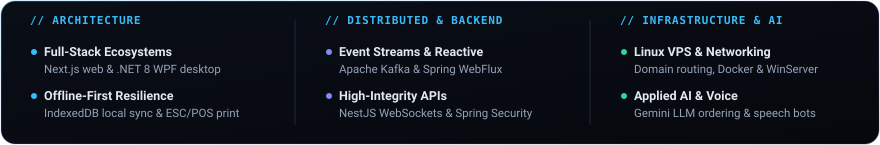
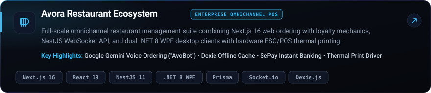
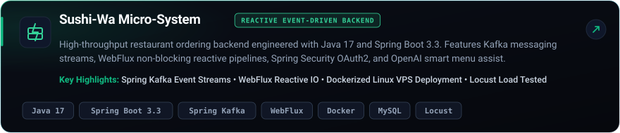
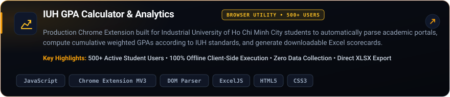
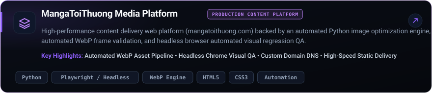

<div align="center">

<!-- HERO BANNER -->


<br/><br/>

<!-- ANIMATED TYPING HEADLINE -->
<a href="https://github.com/Kain6104">
  
</a>

<br/>

<!-- ARCHITECTURE CAPABILITY SUMMARY CARD -->


</div>

<br/>


<br/>

## 01 &nbsp; // &nbsp; About Me

```yaml
identity:
  name: Huynh Thanh Phat (Kain)
  role: Full-Stack Engineer & System Integrator
  education: Final-Year B.S. in Information Technology
  institution: Industrial University of Ho Chi Minh City (IUH)
  focus_areas:
    - Enterprise Omnichannel & POS Architectures
    - High-Throughput Reactive Microservices
    - Offline-First Data Synchronization & Hardware Integration
    - Voice AI & Conversational Agents
```

I am a software engineer with a hybrid foundation spanning **modern full-stack product development**, **systems administration**, and **distributed infrastructure**. Currently completing my final year in Information Technology at the Industrial University of Ho Chi Minh City (IUH), my engineering practice focuses on designing end-to-end software systems that remain performant and dependable under real-world operational constraints.

- **Frontend & Omnichannel UX**: Building reactive, accessible web applications with **Next.js 16 (App Router)**, **React 19**, **Tailwind CSS v4**, and **Zustand**, coupled with client-side **IndexedDB (Dexie)** storage for uninterrupted offline capability.
- **Backend Architecture & APIs**: Designing resilient REST and real-time WebSocket backends using **NestJS** and **Spring Boot 3.3**, implementing robust RBAC authentication, Prisma / JPA ORM layers, and non-blocking reactive streams.
- **Desktop & Hardware Systems**: Engineering native **C# / .NET 8 WPF** point-of-sale applications with direct **ESC/POS thermal printer** integration, hardware serial communication, and auto-updating desktop packages.
- **Distributed Messaging & DevOps**: Orchestrating asynchronous message flows with **Apache Kafka**, managing **Linux VPS (Ubuntu)** environments, containerizing services with **Docker**, and provisioning DNS and network routing.
- **Applied Artificial Intelligence**: Integrating **Google Gemini API** and speech-to-text models into production voice-ordering assistants (*AvoBot*), turning natural language into verified business transactions.

<br/>


<br/>

## 02 &nbsp; // &nbsp; Tech Stack & Ecosystem

<br/>

<table>
  <thead>
    <tr>
      <th width="30%" align="left">Domain</th>
      <th width="70%" align="left">Technologies &amp; Verified Tooling</th>
    </tr>
  </thead>
  <tbody>
    <tr>
      <td align="left">
        <strong>Languages</strong>
      </td>
      <td align="left">
        <a href="https://skillicons.dev"></a>
        <br/>
        <code>TypeScript</code> &bull; <code>JavaScript (ESNext)</code> &bull; <code>Java 17+</code> &bull; <code>C# (.NET 8)</code> &bull; <code>Python</code> &bull; <code>SQL</code>
      </td>
    </tr>
    <tr>
      <td align="left">
        <strong>Backend &amp; Microservices</strong>
      </td>
      <td align="left">
        <a href="https://skillicons.dev"></a>
        <br/>
        <code>NestJS 11</code> &bull; <code>Spring Boot 3.3</code> &bull; <code>Node.js</code> &bull; <code>Spring WebFlux</code> &bull; <code>Prisma ORM</code> &bull; <code>Hibernate / JPA</code> &bull; <code>WebSockets (Socket.io)</code>
      </td>
    </tr>
    <tr>
      <td align="left">
        <strong>Frontend &amp; UI Engineering</strong>
      </td>
      <td align="left">
        <a href="https://skillicons.dev"></a>
        <br/>
        <code>Next.js 16 (App Router)</code> &bull; <code>React 19</code> &bull; <code>Tailwind CSS v4</code> &bull; <code>Zustand</code> &bull; <code>Dexie.js (IndexedDB)</code> &bull; <code>SWR</code> &bull; <code>Recharts</code>
      </td>
    </tr>
    <tr>
      <td align="left">
        <strong>Desktop &amp; Systems</strong>
      </td>
      <td align="left">
        <a href="https://skillicons.dev"></a>
        <br/>
        <code>.NET 8 WPF</code> &bull; <code>WebView2 Runtime</code> &bull; <code>Hardware ESC/POS Thermal Printing</code> &bull; <code>Inno Setup</code>
      </td>
    </tr>
    <tr>
      <td align="left">
        <strong>Data &amp; Event Streaming</strong>
      </td>
      <td align="left">
        <a href="https://skillicons.dev"></a>
        <br/>
        <code>PostgreSQL</code> &bull; <code>MySQL</code> &bull; <code>Microsoft SQL Server</code> &bull; <code>Apache Kafka</code> &bull; <code>Redis</code> &bull; <code>IndexedDB / SQLite</code>
      </td>
    </tr>
    <tr>
      <td align="left">
        <strong>Infrastructure &amp; DevOps</strong>
      </td>
      <td align="left">
        <a href="https://skillicons.dev"></a>
        <br/>
        <code>Linux VPS (Ubuntu)</code> &bull; <code>Docker</code> &bull; <code>Nginx Reverse Proxy</code> &bull; <code>Windows Server (AD / GPO)</code> &bull; <code>DNS &amp; VLAN Routing</code> &bull; <code>Locust Load Testing</code>
      </td>
    </tr>
    <tr>
      <td align="left">
        <strong>Applied AI &amp; Automation</strong>
      </td>
      <td align="left">
        <code>Google Gemini API (Generative AI)</code> &bull; <code>OpenAI API</code> &bull; <code>Speech-to-Text / Voice Interaction</code> &bull; <code>Playwright &amp; Headless QA</code>
      </td>
    </tr>
  </tbody>
</table>

<br/>


<br/>

## 03 &nbsp; // &nbsp; Featured Architectures &amp; Projects

Selected real-world production projects showcasing multi-platform integration, high-concurrency backends, and offline-first resilience:

<br/>

<!-- PROJECT 1: AVORA RESTAURANT -->
<a href="https://github.com/Kain6104/avora-restaurant">
  
</a>

<details>
<summary><b>System Architecture &amp; Implementation Details &mdash; <code>avora-restaurant</code></b></summary>
<br/>

- **Full-Stack Omnichannel Ecosystem**: Seamlessly bridges customer web ordering, administrative management, and point-of-sale desktop terminals into a single synchronized data layer.
- **Frontend Layer**: Built on **Next.js 16** and **React 19** with Tailwind CSS v4, utilizing **Zustand** for state orchestration and **Dexie.js (IndexedDB)** for robust offline data synchronization during network drops. Includes interactive Phaser mini-game loyalty mechanics.
- **Backend & Real-Time Engine**: Built with **NestJS 11** and **TypeScript 5.7**, implementing WebSocket bidirectional streams for live kitchen order status updates, **Prisma ORM**, JWT/Passport Google OAuth2 authentication, and automated Excel reporting via ExcelJS.
- **Desktop POS & Native Hardware**: High-performance **.NET 8 WPF** native application with direct ESC/POS thermal receipt printing, automated cash drawer triggers, and local SQLite state cache.
- **Conversational AI ("AvoBot")**: Integrates **Google Gemini Generative AI** with speech recognition, allowing customers to dictate complex food customizations and execute automated basket checkouts via voice.

</details>

<br/>

<!-- PROJECT 2: SUSHI-WA BACKEND -->
<a href="https://github.com/Kain6104/sushi-wa">
  
</a>

<details>
<summary><b>System Architecture &amp; Implementation Details &mdash; <code>sushi-wa</code></b></summary>
<br/>

- **Event-Driven Reactive Core**: Architected with **Java 17** and **Spring Boot 3.3**, utilizing **Apache Kafka** for asynchronous decoupling between customer order dispatch, inventory auditing, and billing services.
- **Non-Blocking I/O**: Leverages **Spring WebFlux** reactive streams for high-throughput endpoints capable of handling concurrent dining rushes with minimal resource footprint.
- **Enterprise Security & Data**: Implements Spring Security with OAuth2 integration, Spring Data JPA with multi-database support (MySQL, SQL Server, in-memory H2 for integration suites).
- **Resilience & QA**: Containerized with **Docker** and deployed on a configured **Linux VPS** with automated SSL; rigorously benchmarked using distributed **Locust** load test scenarios.

</details>

<br/>

<!-- PROJECT 3: IUH GPA TOOL -->
<a href="https://github.com/Kain6104/IUH-GPA-Tool">
  
</a>

<details>
<summary><b>System Architecture &amp; Implementation Details &mdash; <code>IUH-GPA-Tool</code></b></summary>
<br/>

- **Production Academic Utility**: Chrome Extension (Manifest V3) adopted by **over 500 active university students** at Industrial University of Ho Chi Minh City (`sv.iuh.edu.vn`).
- **Client-Side Transcript Engine**: Injects clean DOM parsers into student grade portals, extracting historical course results, credit weights, and letter grades in sub-millisecond time.
- **100% Privacy & Zero-Latency**: All statistical evaluations run completely offline in the user's browser sandbox, ensuring sensitive academic credentials never leave the client machine.
- **Data Portability**: Incorporates an in-browser spreadsheet generation module allowing one-click export of structured Excel (`.xlsx`) scorecards.

</details>

<br/>

<!-- PROJECT 4: MANGATOITHUONG MEDIA PLATFORM -->
<a href="https://github.com/Kain6104/MangaToiThuong_Web">
  
</a>

<details>
<summary><b>System Architecture &amp; Implementation Details &mdash; <code>MangaToiThuong_Web</code></b></summary>
<br/>

- **High-Performance Content Delivery**: Production web platform serving rich graphical media at `mangatoithuong.com` with sub-second asset latency.
- **Automated Processing Pipeline**: Custom Python scripts automate image scaling, color depth correction, and WebP frame compression to minimize bandwidth overhead.
- **Headless Visual Regression QA**: Automated headless browser testing scripts (Playwright/Chrome) audit layout stability, asset completeness, and rendering fidelity prior to release.

</details>

<br/>


<br/>

## 04 &nbsp; // &nbsp; Engineering Analytics &amp; Activity

<div align="center">

<table border="0" cellspacing="0" cellpadding="0">
  <tr>
    <td align="center" valign="top">
      <a href="https://github.com/Kain6104">
        
      </a>
    </td>
    <td align="center" valign="top">
      <a href="https://github.com/Kain6104">
        
      </a>
    </td>
  </tr>
  <tr>
    <td colspan="2" align="center" valign="top">
      <br/>
      <a href="https://github.com/Kain6104">
        
      </a>
    </td>
  </tr>
</table>

</div>

<br/>


<br/>

## 05 &nbsp; // &nbsp; Development Philosophy

The core architectural principles that guide how I build and deploy software:

<br/>

<table>
  <tr>
    <td width="50%" valign="top">
      <h4>01. Architecture Precedes Code</h4>
      <p>Clean domain separation, deliberate schema modeling, and modular abstraction take priority over premature coding. Building resilient software begins with understanding the lifecycle of data and the failure modes of each dependency.</p>
    </td>
    <td width="50%" valign="top">
      <h4>02. Offline-First &amp; Hardware Resilience</h4>
      <p>Networks will partition and peripheral hardware will disconnect. Production client applications must maintain local caching (IndexedDB/SQLite), provide instantaneous optimistic UI responses, and reliably reconcile state upon reconnection.</p>
    </td>
  </tr>
  <tr>
    <td width="50%" valign="top">
      <h4>03. Full-Spectrum Systems Empathy</h4>
      <p>A web application does not run in a vacuum. True engineering excellence bridges the entire continuum: from low-level Linux daemon management, DNS records, and Docker resource limits, up through WebSocket protocol frames and front-end render loops.</p>
    </td>
    <td width="50%" valign="top">
      <h4>04. Pragmatic &amp; Applied Intelligence</h4>
      <p>AI integrations should solve measurable operational friction, not merely act as decorative gimmicks. Leveraging LLMs for voice-guided ordering, natural language query resolution, and automated QA testing directly elevates real user outcomes.</p>
    </td>
  </tr>
</table>

<br/>


<br/>

## 06 &nbsp; // &nbsp; Connect &amp; Collaborate

I am actively open to **Software Engineering**, **Full-Stack Development**, and **Backend Systems** opportunities where robust architecture, product velocity, and craftsmanship matter.

<br/>

<div align="center">

<a href="mailto:htphat.fit@gmail.com">
  
</a>
&nbsp;
<a href="https://github.com/Kain6104">
  
</a>
&nbsp;
<a href="https://www.iuh.edu.vn">
  
</a>
&nbsp;


<br/><br/>

<sub>Crafted with precision &bull; Designed in dark theme &bull; © 2026 Huynh Thanh Phat (Kain6104)</sub>

</div>
